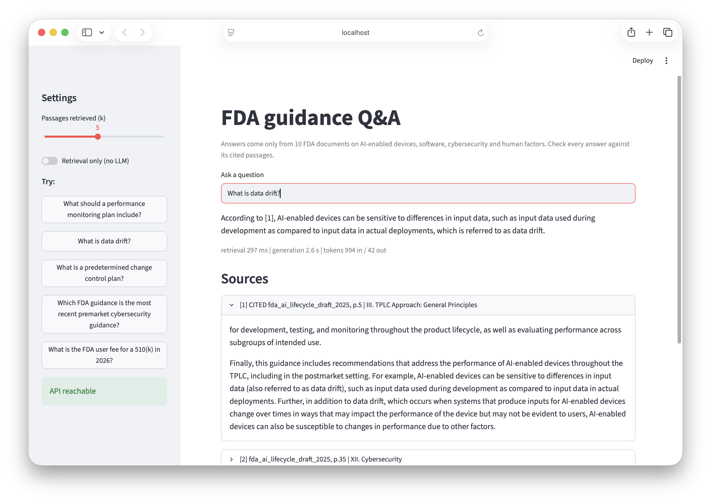
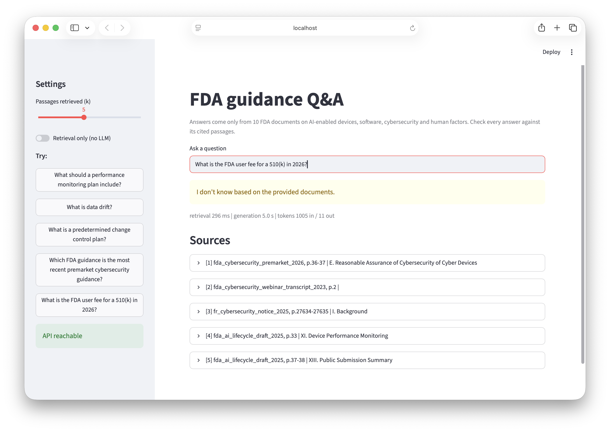
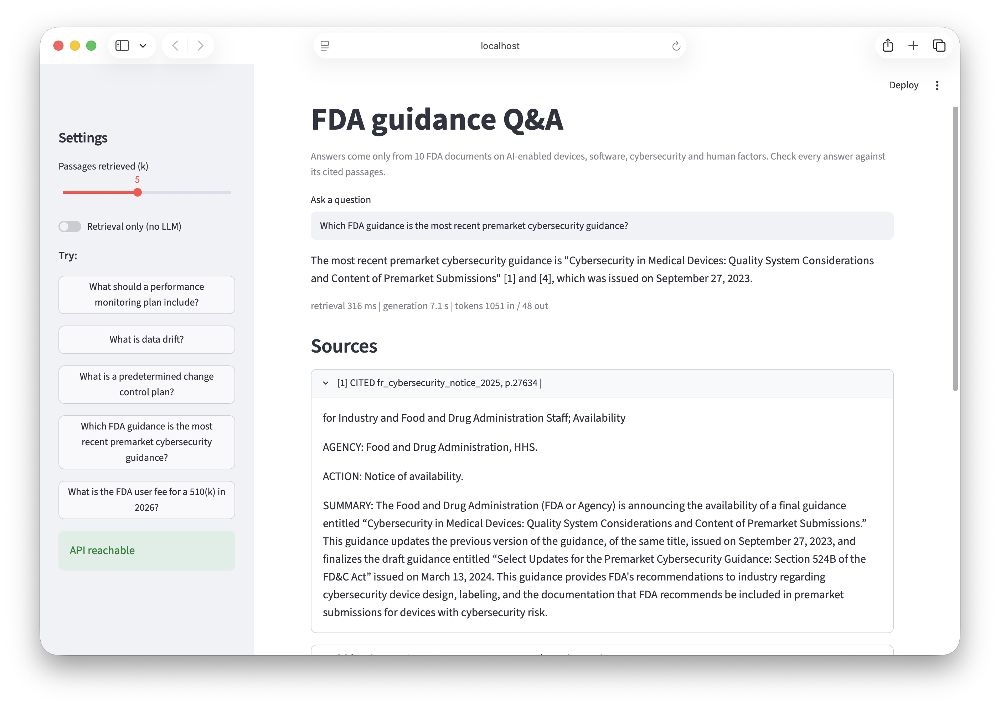

# FDA AI-device guidance Q&A: a RAG system with measured quality

Question answering over 10 real FDA documents on AI-enabled medical devices, device software, cybersecurity and human factors. Every answer is cited to a document and page, and the project is built around **measuring** retrieval and answer quality, including where it fails.

Everything runs locally and for free: sentence-transformers + Chroma + BM25, `llama3.1:8b` via Ollama, a FastAPI service, a Streamlit UI and a Docker image. Nothing here required a paid API.

## Headline results

| | Dense retrieval (baseline) | Hybrid BM25 + dense |
|---|---|---|
| Gold passage in top 5 (hit@5) | 0.694 | **0.857** |
| MRR | 0.510 | **0.696** |
| Answers fully correct (49 questions) | 24 (49%) | **34 (69%)** |
| Answers incorrect | 12 | **2** |
| Questions improved / regressed by hybrid | | 13 / 3 (33 unchanged) |

With the gold passage handed to the generator directly, 47 of 49 answers were correct, so **retrieval, not generation, was the bottleneck**. Hybrid search was the only change with a clear, statistically supported effect (paired interval excludes 0).

What did **not** help, tested and reported below: chunk size and overlap, larger or different embedding models, two cross-encoder rerankers, and an LLM "is the evidence sufficient?" gate. The main unsolved failure is the system **answering confidently when retrieval misses** (see Failures).

Read the limits section before quoting any number: 49 questions, written from the same corpus, so intervals are wide.

## Screenshots

A cited answer: the supporting sentence is visible in the expanded source.



A refusal on a question the documents do not cover (a 510(k) user fee).



A known failure. The system states that the most recent premarket cybersecurity guidance was issued on September 27, 2023, but the corpus contains versions from June 2025 and February 2026 that supersede it. The cited source is the 2025 Federal Register notice, whose own text says it updates the 2023 version.



## Corpus

10 documents, 258 pages, 995 chunks (US federal government publications):

| Type | Documents |
|---|---|
| FDA PDFs (5) | AI-enabled device lifecycle draft guidance (Jan 2025), premarket cybersecurity guidance (Feb 2026), premarket software content guidance (2023), human factors guidance (2016), 2023 cybersecurity webinar transcript |
| Federal Register notices (5) | PCCP final guidance notice (2024), AI lifecycle draft notice (2025), cybersecurity notices (2023, 2025), human factors notice (2016) |

The set is deliberately messy: margin line numbers, repeated headers, footnotes, three-column layout, spoken-language transcripts, and overlapping versions of the same guidance (2023 / 2025 / 2026 cybersecurity). `fda.gov`, `hhs.gov` and `federalregister.gov` reject scripted downloads, so five FDA PDFs are downloaded by hand; `python src/rag/collect.py` prints the URL for each missing file and validates everything it finds (PDF signature, no access-gate pages). `data/manifest.json` records source, size, hash and how each file was acquired. One planned document (the PCCP webinar transcript) was never collected.

## How it works

```
raw PDF/HTML -> parse (per-family profiles) -> page records -> chunk (1000 chars, 150 overlap)
   -> bge-small embeddings (Chroma) + BM25 -> reciprocal rank fusion -> top 5
   -> llama3.1:8b (temperature 0, must cite [n], must say "I don't know" if unsupported)
```

- **Parsing** (`src/rag/parse_pdf.py`, `parse_html.py`): margin line numbers removed by position, headers by position, footnotes separated by font size, three-column pages ordered column-first, fused words repaired, printed page numbers kept for citations. Settings are explicit per document family because a parser tuned on one file silently broke on others.
- **Chunking** (`src/rag/chunk.py`): paragraph-aware, crosses page boundaries, keeps section and page range, drops table-of-contents leader lines.
- **Retrieval** (`src/rag/retriever.py`): exact dense search + BM25, fused with reciprocal rank fusion (k=60, 30 candidates each). Chosen over weighted score mixing because it has nothing to tune on a small question set.
- **Service** (`api/main.py`): `/health`, `/search` (retrieval only), `/ask` (answer + cited sources + token and timing metrics). 503 if the generator is down. Request metrics are logged without question text.

## Retrieval experiments

All configurations were scored on the same 49 answerable-type questions with page-range gold labels. The right-hand columns are **paired** comparisons against the baseline (per-question change in reciprocal rank, bootstrap 95% interval).

| Configuration | hit@1 | hit@5 | hit@10 | MRR | dMRR vs baseline (95% paired CI) | better/worse | rerank s/q |
|---|---|---|---|---|---|---|---|
| Baseline: dense, bge-small, 1000/150 | 0.388 | 0.694 | 0.857 | 0.510 | - | - | 0 |
| Dense, bge-small-en-v1.5, 500/75 | 0.531 | 0.694 | 0.776 | 0.601 | +0.091 [-0.018, +0.202] | 15/12 | 0 |
| Dense, bge-small-en-v1.5, 2000/300 | 0.347 | 0.714 | 0.837 | 0.502 | -0.008 [-0.112, +0.089] | 17/14 | 0 |
| Dense, bge-small-en-v1.5, 1000/0 | 0.469 | 0.735 | 0.857 | 0.587 | +0.077 [-0.036, +0.188] | 21/10 | 0 |
| Dense, bge-small-en-v1.5, 1000/300 | 0.388 | 0.714 | 0.837 | 0.517 | +0.007 [-0.070, +0.082] | 12/15 | 0 |
| Dense, bge-base-en-v1.5, 1000/150 | 0.449 | 0.755 | 0.857 | 0.564 | +0.053 [-0.009, +0.127] | 11/9 | 0 |
| Dense, all-MiniLM-L6-v2, 1000/150 | 0.408 | 0.735 | 0.857 | 0.540 | +0.030 [-0.054, +0.115] | 13/11 | 0 |
| BM25 only, 1000/150 | 0.653 | 0.878 | 0.918 | 0.753 | +0.243 [+0.120, +0.366] * | 22/8 | 0 |
| Hybrid BM25 + dense (RRF), 1000/150 | 0.612 | 0.857 | 0.898 | 0.696 | +0.186 [+0.094, +0.287] * | 19/6 | 0 |
| Hybrid + rerank ms-marco-MiniLM-L-6-v2 | 0.510 | 0.837 | 0.857 | 0.628 | +0.117 [+0.026, +0.216] * | 17/11 | 0.086 |
| Hybrid + rerank bge-reranker-base | 0.673 | 0.837 | 0.898 | 0.745 | +0.235 [+0.117, +0.351] * | 25/5 | 0.509 |

`*` = paired 95% interval excludes 0. n=49 answerable-type questions; 10 comparisons against the baseline, so one starred row can appear by chance.

Reading the table:

- **Hybrid search is the one clear win:** +0.186 MRR [+0.094, +0.287], with 19 questions better and 6 worse. BM25 alone scored higher (+0.243), but BM25 vs hybrid is not distinguishable (+0.057 [-0.039, +0.156]). Hybrid was chosen because it lost fewer questions from the top 5 (1 vs 3), a judgment about unknown question styles, not a measured result.
- **BM25's advantage grows with vocabulary overlap** between question and answer passage (MRR gain over dense: +0.154 in the lowest-overlap third, +0.236 in the middle, +0.333 in the highest). Many questions were drafted by an LLM that saw the passage, so the real-world gain is probably closer to the low end.
- **No detectable effect** from chunk size or overlap (500 / 1000 / 2000 characters; 0 / 15 / 30% overlap), or from the embedding model (bge-base +0.053 [-0.009, +0.127]; MiniLM +0.030 [-0.054, +0.115]).
- **The two reranker rows are starred only because they inherit hybrid's gain over dense.** The actual test of a reranker is against hybrid: ms-marco-MiniLM -0.068 [-0.154, +0.007]; bge-reranker-base +0.049 [-0.044, +0.144] at 0.51 s per query. Neither was adopted.
- Of 49 questions, 34 have the gold passage in the dense top 5, 8 more appear at ranks 6-10, and 7 are outside the top 10.

## Answer quality

Judge: `qwen2.5:7b` (a different model family from the generator), correctness only.

| Context given to llama3.1:8b | Correct | Partial | Incorrect | Refused |
|---|---|---|---|---|
| Dense top 5 (49 questions) | 24 | 13 | 12 | 8 |
| Hybrid top 5 (49 questions) | 34 | 13 | 2 | 1 |
| Gold passages (oracle) | 47 | 2 | 0 | 0 |

**Faithfulness is not reported.** The local judge agreed with my grades on supported-vs-unsupported for only 7 of 15 answers and always erred toward "unsupported", so I dropped the number. Two judge-free proxies (token grounding, cited-source word overlap) were also tested and dropped: they flagged 1 useful case, 3 false alarms, and missed the clearest unfaithful answer.

## Failures (what a user can run into)

1. **Confident answers when retrieval misses.** Of the 7 questions whose gold passage was not in the hybrid top 5, the system refused 1, gave a partial answer to 5, and a wrong answer to 1. The wrong one asked for the most recent version of the premarket cybersecurity guidance (2023, 2025 and 2026 versions all exist in the corpus), and the answer named a version with a citation and an authoritative tone. Passing this case through an LLM "is the evidence sufficient?" gate did not catch it either.
2. **Unsupported commentary and wrong citation numbers.** In a 15-answer manual review, 2 answers added claims the sources did not contain (for example "the document states this list is not exhaustive"), and 2 cited the wrong source number even though the claim was supported elsewhere in the context.
3. **Refusal is driven by topic, not evidence.** All 16 unanswerable questions (6 easy, 10 harder: adjacent-topic, false-premise, out-of-scope) got the identical one-line refusal, including 3 false-premise questions where a better answer would correct the premise. That looks like a conservative prompt, not calibration, and the retrieval-distance gap between answerable and unanswerable questions was too small to threshold.
4. **An LLM sufficiency gate cost more than it saved:** it blocked 6 of 34 (llama3.1) or 9 of 34 (qwen2.5) answers that were correct, and passed the one wrong answer. Not adopted.

## Evaluation limits (read before quoting any number)

- **55 questions, 49 used for retrieval metrics.** Intervals are about +/-13 points, and with 10 comparisons against one baseline a lone starred row could be chance.
- **Questions were written from this corpus.** 41 were drafted by `llama3.1:8b` from sampled passages, then reviewed and rewritten by Claude, not by a human domain expert; 14 were hand-written (unanswerable, cross-document, version-conflict). This favors lexical matching.
- **Spot-check:** 10 sampled labels, 8 fine and 2 needing fixes (a circular question and an inferred phrase). A systematic pass then revised 14 questions and rejected 1. The author's spot-check was not independent: the reviewer's verdicts had been shown first.
- **Judge calibration** (13 of 15 correctness verdicts matched) was against grades I wrote, not a human's, and the judge is lenient on completeness, so the gap between dense and hybrid answers is probably understated.
- **The unanswerable set is small and author-written.** 16 refusals out of 16 is not evidence of robust hallucination handling.
- **Known parsing defect:** the PDFs' square bullet glyphs are extracted as private-use Unicode characters that no font renders. They are present in 22 of 995 chunks (13 of 258 pages) and show up as empty boxes in answers and sources. The app replaces them with a bullet for display, but the index and the reported metrics were built on the uncleaned text, so their effect on retrieval was not measured.
- **An unexplained reproducibility issue:** building an index and querying it in the same process gave slightly different retrieval for one question than reopening it later (query vectors were bit-identical, and exact search matched Chroma after reopening). The cause is unknown; the experiment harness builds and evaluates in separate processes.

## Cost and latency

Measured locally (16 GB Apple-silicon Mac, `llama3.1:8b` through Ollama, quantization not verified):

- Retrieval about 50 ms (0.7% of end-to-end time); generation median 8.7 s, p95 11.6 s (14 warm queries); first query after idle +4.3 s for model load; prefill is about 4.2 s per ~1,000 prompt tokens, and decoding about 20 tokens/s.
- Estimated API cost for the same token volume (983 input / 90 output tokens per query, Llama tokenizer; Claude 4.7+ tokenizers produce about 30% more tokens):

| Model | $/query | $/1,000 queries | with +30% tokens |
|---|---|---|---|
| Claude Haiku 5.5 ($0.10 / $0.50) | 0.00014 | 0.14 | 0.19 |
| Claude Sonnet 5.5 ($2 / $10) | 0.00286 | 2.86 | 3.72 |
| Claude Opus 5.5 ($4 / $20) | 0.00573 | 5.73 | 7.45 |
| Claude Fable 5.1 ($10 / $50) | 0.01432 | 14.32 | 18.62 |

Prices are Anthropic's list prices per million tokens as checked on 2026-10-26. This is a paper estimate; nothing was purchased. Model choice dominates cost, and the retrieval stack costs nothing per query.

## Run it

Needs Python 3.11 and [Ollama](https://ollama.com) with `llama3.1:8b` pulled.

    python -m venv .venv && source .venv/bin/activate && pip install -r requirements.txt
    python src/rag/collect.py            # lists the 5 files to download by hand into data/raw/
    PYTHONPATH=src python -m rag.ingest  # parse -> data/processed/pages.jsonl
    PYTHONPATH=src python -m rag.chunk && PYTHONPATH=src python -m rag.index
    PYTHONPATH=src python -m uvicorn api.main:app --port 8000
    streamlit run app/streamlit_app.py
    python -m pytest -q                  # 8 stubbed tests, no models needed

Docker: `docker build -t rag-eval:0.2 .` then `docker run -p 8000:8000 rag-eval:0.2`. The container serves the API and reaches Ollama on the host (`OLLAMA_URL`); it does not bundle a language model.

## Next steps

- Questions written by someone who has not seen the passages, graded by a human, to replace the author-written set.
- Version-aware metadata (issue date, superseded-by) to target failures like the cybersecurity-version question.
- Evidence-aware refusal that does not rely on an LLM judging its own context.
- Fewer retrieved passages (3 instead of 5) should cut prefill time; untested.
- A hosted retrieval-only demo; free tiers cannot run an 8B model, so the full pipeline is shown in a recording instead.
